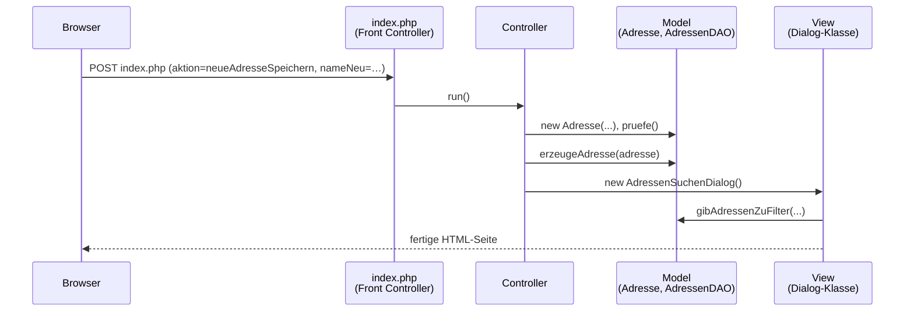

# Adressverwaltung – eine PHP-Anwendung nach dem MVC2-Muster

Diese kleine Anwendung verwaltet Adressen (Name, PLZ, Ort). Man kann Adressen
suchen, filtern, sortieren, neu anlegen, bearbeiten und löschen. Die Anwendung
ist bewusst einfach gehalten: Es gibt keine Datenbank, alle Daten liegen in der
PHP-Session. Im Mittelpunkt steht der **Aufbau nach dem MVC2-Muster**.

## Das MVC-Muster

**MVC** (*Model – View – Controller*) teilt eine Anwendung in drei Bereiche
mit klar getrennten Aufgaben:

| Bereich        | Aufgabe                                                                 | In dieser Anwendung                          |
|----------------|-------------------------------------------------------------------------|----------------------------------------------|
| **Model**      | Fachliche Daten und Regeln: Was ist eine Adresse, wann ist sie gültig, wo wird sie gespeichert? | `model/Adresse.php`, `model/AdressenDAO.php` |
| **View**       | Darstellung: Erzeugt die HTML-Seite, die der Benutzer sieht.             | `view/AdressenSuchenDialog.php`, `view/AdresseAnlegenDialog.php` |
| **Controller** | Steuerung: Nimmt die Anfrage entgegen, entscheidet, was passiert, und wählt die passende View aus. | `controller/Controller.php`                  |

Der Vorteil: Jeder Bereich kann unabhängig von den anderen geändert werden.
Ein neues Seitenlayout betrifft nur die Views, eine neue Prüfregel für
Postleitzahlen nur das Model, und ein zusätzlicher Arbeitsablauf vor allem
den Controller.

## Was ist MVC2 („Model 2“)?

Das ursprüngliche MVC stammt aus der Welt der Desktop-Anwendungen. Dort bleibt
eine View dauerhaft geöffnet und wird vom Model automatisch benachrichtigt,
wenn sich Daten ändern (Beobachter-Muster).

Im Web funktioniert das so nicht: Der Browser schickt eine **HTTP-Anfrage**,
der Server antwortet mit einer **fertigen HTML-Seite**, und danach ist die
Verbindung beendet. Eine View kann also nicht „live“ aktualisiert werden.
**MVC2** (auch *Model 2* genannt, ursprünglich aus der Java-Welt mit Servlets
und JSPs) ist die Anpassung von MVC an dieses Anfrage-Antwort-Prinzip:

1. **Ein zentraler Einstiegspunkt** (*Front Controller*): Alle Anfragen gehen
   an dieselbe Adresse – hier `index.php`. Es gibt keine einzelnen PHP-Seiten,
   die der Benutzer direkt aufruft.
2. **Der Controller wertet die Anfrage aus**: Welche Aktion will der Benutzer
   ausführen? Hier steht sie im versteckten Formularfeld `aktion`.
3. **Der Controller arbeitet mit dem Model**: Er erzeugt Model-Objekte, lässt
   sie prüfen und speichert oder löscht sie.
4. **Der Controller wählt eine View aus**, die die Antwortseite erzeugt.
5. **Die View erzeugt HTML** und schickt es an den Browser. Danach ist die
   Anfrage abgeschlossen.

Jeder Klick auf einen Button ist also eine neue Anfrage, die diesen Zyklus
einmal komplett durchläuft.



## Aufbau der Anwendung

```
adress-management/
├── index.php                  Front Controller: Einstieg für jede Anfrage
├── controller/
│   └── Controller.php         wertet "aktion" aus und steuert den Ablauf
├── model/
│   ├── Adresse.php            eine Adresse inkl. Prüfregeln (Validierung)
│   └── AdressenDAO.php        Datenzugriff: Speichern, Suchen, Löschen
├── view/
│   ├── AdressenSuchenDialog.php   Seite mit Filter und Ergebnisliste
│   └── AdresseAnlegenDialog.php   Formular zum Anlegen/Bearbeiten
├── css/style.css              Gestaltung aller Seiten
└── js/funktionen.js           kleine Hilfsfunktionen im Browser
```

Die Ordner entsprechen den PHP-**Namespaces**: Die Klasse `model\Adresse`
liegt in `model/Adresse.php`. Der **Autoloader** in `index.php` nutzt das aus
und lädt jede Klasse automatisch, sobald sie zum ersten Mal verwendet wird –
`require`-Anweisungen in den einzelnen Dateien sind dadurch nicht nötig.

### index.php – der Front Controller

`index.php` ist die einzige Datei, die der Browser aufruft. Sie

1. registriert den Autoloader,
2. startet die Session,
3. legt beim ersten Aufruf den `Controller` und das `AdressenDAO` an und
   speichert beide in der Session,
4. übergibt die Anfrage an `$controller->run()`.

### Controller – die Steuerung

`Controller::run()` liest das Formularfeld `aktion` und ruft die passende
Methode auf. Beim allerersten Aufruf gibt es noch kein Formular und damit
keine Aktion; dann wird nur der Filter angezeigt.

| Aktion (`aktion`)             | Was passiert                                                    | Folgeseite                  |
|-------------------------------|-----------------------------------------------------------------|-----------------------------|
| *(keine)* / `filterAnzeigen`  | –                                                               | Suchseite ohne Ergebnisse   |
| `suchen`                      | Adressen passend zum Filter ermitteln                           | Suchseite mit Ergebnissen   |
| `neueAdresseAnlegen`          | –                                                               | leeres Eingabeformular      |
| `neueAdresseSpeichern`        | Adresse prüfen und speichern                                    | Suchseite (bei Fehler: Formular mit Meldung) |
| `adresseBearbeiten`           | gewählte Adresse laden                                          | ausgefülltes Formular       |
| `adressBearbeitungSpeichern`  | Änderungen prüfen und übernehmen                                | Suchseite (bei Fehler: Formular mit Meldung) |
| `adresseLoeschen`             | gewählte Adresse löschen                                        | Suchseite                   |

Fehler bei der Prüfung meldet das Model mit einer **Exception**. Der
Controller fängt sie ab und zeigt das Formular mit der Fehlermeldung erneut an.

### Model – Daten und Regeln

- **`Adresse`** ist ein einfaches Datenobjekt mit Gettern und Settern. Die
  Methode `pruefe()` enthält die Geschäftsregeln (Name, PLZ und Ort dürfen
  nicht leer sein, die PLZ muss eine positive Zahl sein).
- **`AdressenDAO`** (*Data Access Object*) kapselt den Zugriff auf die
  gespeicherten Daten. Hier ist das nur ein PHP-Array in der Session. Würde man
  später eine Datenbank verwenden, müsste man **nur diese Klasse** ändern –
  Controller und Views bleiben unverändert, weil sie nur die Methoden des DAO
  kennen.

### View – die Darstellung

Jeder Dialog ist eine Klasse, deren Methode die komplette HTML-Seite ausgibt.
PHP und HTML sind dabei gemischt: Zwischen `?>` und `<?php` steht HTML, das
direkt ausgegeben wird; mit `<?= ... ?>` werden einzelne Werte eingefügt.

Alle Werte, die (auch indirekt) vom Benutzer stammen, werden mit
`htmlspecialchars()` ausgegeben. Sonst könnte jemand z. B. als Namen
`<script>…</script>` eingeben, und dieser Code würde im Browser ausgeführt
(*Cross-Site-Scripting*, XSS).

### Wie der Browser die Aktion mitteilt

Jede Seite besteht aus einem einzigen Formular mit einem versteckten Feld:

```html
<input type="hidden" id="aktion" name="aktion" value="suchen">
```

Die Buttons sind keine Submit-Buttons, sondern rufen die JavaScript-Funktion
`behandleButton(formular, aktion)` auf. Diese trägt die gewünschte Aktion in
das versteckte Feld ein und schickt das Formular ab. So landen **alle** Klicks
als POST-Anfrage bei `index.php`, und der Controller erkennt am Feld `aktion`,
was zu tun ist.

### Zustand in der Session

HTTP ist zustandslos: Der Server „vergisst“ nach jeder Anfrage alles. Damit die
Adressen zwischen zwei Klicks erhalten bleiben, liegen Controller und DAO in der
Session (`$_SESSION`). PHP speichert die Objekte am Ende jeder Anfrage und
stellt sie bei der nächsten Anfrage wieder her.

